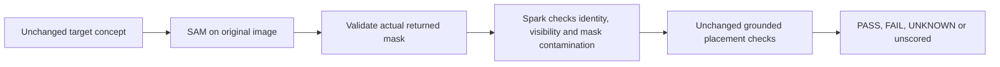

# Elite-hackathon assessment and execution priorities

Assessment date: 30 October 2026, Asia/Almaty. This is a skeptical internal assessment, not an organizer's evaluation or a prediction based on competing entries.

**The current evidence would not put ProofLoop on my winning shortlist in an exceptionally strong field.** The engineering is substantial, but the useful capability and demonstration are behind it. A test count cannot compensate for rejecting both clear positive controls or for an unvalidated user benefit.

## Rubric assessment

The [current official rules](https://cerebralvalley.ai/e/meta-ai-developer-hackathon/waiver) specify Impact 30%, Meta tooling 25%, Technical depth/execution 20% and Demo 25%. A review agent re-read the live public rules through HTTPS for this assessment. The [official Meta overview](https://dev.meta.ai/events/global-hackathon) also emphasizes creativity, technical ambition and whether an Indie entry works. Application-selection criteria are a different rubric.

My subjective starting score is **53/100**. This is a diagnostic judgment, not a probability of winning or an official score.

| Criterion | Working score | What limits it |
| --- | ---: | --- |
| Impact | 10.5/30 | No external user observation, measured workflow benefit or completed current operator-followed repair. |
| Meta tooling | 17.5/25 | Spark and SAM perform essential work, but their combination has not yet established useful positive retention across tasks. |
| Technical execution | 15/20 | Strong evidence control, durable jobs and reproduction; the central perception path still fails clear-object controls. |
| Demo | 10/25 | The current script centers cached policy diagnostics. The useful intervention is harder to see than the implementation details. |

## What an elite judge would challenge

1. **Does it work when the user did the right thing?** The [new-family pilot](NEW-SOURCE-RESULTS-20261029.md) gives guided 7/9 matches, but eight UNKNOWN outputs and 0/2 accepted clear positives. Its [padding follow-up](ANCHOR-PADDING-DEVELOPMENT-20261030.md) returns UNKNOWN on every case. Conservative refusal alone is not a useful verifier.
2. **What exactly did SAM add?** A box-prompted SAM result carries Spark-assigned identity. The high-scoring fork/spoon union demonstrates that a valid mask and score do not independently verify the named instance. The old semantic challenger reviewed rectangular candidates, rather than the returned foreground. This is a concrete missing check.
3. **What customer outcome is demonstrated?** A robotics developer checking visible placement subgoals is a defensible initial user. Adoption, saved time, fewer failed runs and demand are still hypotheses. Manufacturing quality, hidden state and physical safety have not been validated.
4. **What is new relative to prior work?** [REFLECT](https://robot-reflect.github.io/) already connects robot failure explanations to correction planning. [KnowNo](https://robot-help.github.io/) already connects uncertainty to requests for help. ProofLoop's stronger differentiator is the inspectable binding between a reviewed task, supported observations, missing evidence and a bounded next action. It has not inherited either system's experimental results or guarantees.
5. **Can the three-minute video prove the defining promise?** A current request followed by an incorrect repair, rejection, correct repair and fresh verification would be compelling. A later prerecorded passing frame does not establish that an operator or robot followed our request. The existing recorded fork/spoon sequence remains useful observation evidence with that explicit limit.

Meta's [embodied-AI release](https://ai.meta.com/blog/fair-robotics-open-source/) discusses the difficulty of physical perception and human-robot collaboration. Its [V-JEPA 2 work](https://ai.meta.com/blog/v-jepa-2-world-model-benchmarks/) pursues understanding, prediction and planning in physical environments. This supports the relevance of the problem. It is an inference about alignment, not evidence of Meta's interest in this particular submission or an integration with those systems.

## Improvement being implemented first

The immediate intervention is **concept proposals with a mask-aware semantic veto**:

SAM receives the actual positive noun phrase, rather than an imprecise Spark spatial anchor. A new challenge examines the source scene, deterministic context crop and actual mask. It must withhold mixed-instance masks, uncertain identity, incomplete target extent and occlusion. Cached visibility/ambiguity vetoes remain effective. The method cannot lower confidence 0.8, drop the two-view requirement, enlarge the approved acceptance regions or borrow the reference labels.

The exposed development set keeps **all nine cases: two PASS, one FAIL and six UNKNOWN**. The maximum is eighteen SAM requests plus nine one-request Spark challenges, with no retries. Raw errors remain unscored, every planned case stays in the denominator, and earlier results remain unchanged. Success would mean recovering both positive controls while retaining the wrong-placement FAIL and withholding all six unclear controls. A favorable development result still needs separately frozen new recordings before production promotion.

## What comes next if the perception gate succeeds

1. Validate on separately selected, previously untested recordings and keep original-family/camera correlation explicit. A new episode is not a new domain.
2. Connect the qualified method to one narrowly reviewed task. A setup qualification can explain unsupported target concepts before a user invests in the procedure; it cannot grant authority to future observations.
3. Use the existing workbench for a current operator-followed correction trial, including one wrong repair and new post-request observations. Preserve failed trials. Online footage can test chronological observations but cannot fill this intervention gap.
4. Rewrite the demo around that concrete user outcome: problem, wrong state, rejected wrong repair, accepted correction, uncertainty branch and the evidence that supports each decision. Keep implementation and cached diagnostics as supporting evidence.
5. Obtain an unfamiliar person's observed run and feedback when available. Do not invent customers, time savings or industrial deployment.

The goal is a small capability that reliably earns its claim. Additional infrastructure becomes worthwhile when it supports that capability or resolves an observed operational defect.

## Result of the first intervention

The [completed concept-mask experiment](CONCEPT-MASK-RESULTS-20261030.md) fails the gate: 5/9 reference matches, 0/2 clear positives and one incorrect PASS on the ambiguous cloth pair. Its separate mixed-mask control succeeds. The 20-call trial costs an estimated $0.056607. Independent raw-response, source and accounting replay passes, but that does not rescue the failed capability. The method remains outside production; the initial competitive verdict remains unchanged.

The [text-gripper follow-up](IMAGE-GRIPPER-RESULTS-20261030.md) also fails: all 18 SAM responses contain no gripper masks, so no proximity comparison is available. A [final six-view manual spatial control](SPATIAL-GRIPPER-CONTROL-20261030.md) produces the expected one near warning and five no-near comparisons. This isolates automatic proposal availability as a measured bottleneck. Manual initialization and correlated exposed images limit the result; it is not a production fix or new task-accuracy score.

The [exact operator-trial guide](OPERATOR-TRIAL-20261030.md) is prepared for later at the participant's request. The remaining priorities are reliable positive support on one narrow workflow, an actual request followed by fresh verification, and an observed unfamiliar user's benefit. Do not raise the competitive score because of test count, additional experimental code or the six manually initialized controls.
